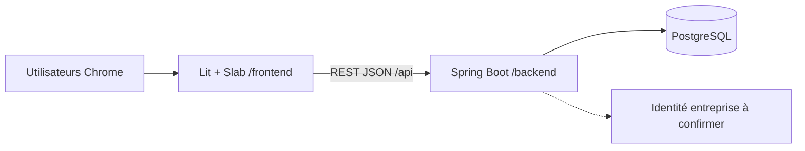

# Pôle formation INT — référentiel du projet

Application interne de centralisation du pôle formation INT : référentiels, formations, sessions, participations et pilotage de l'activité formation.

> **Statut** : les fonctionnalités du backlog MVP sont implémentées localement : référentiels, catalogue et correspondances, sessions et intervenants, collaborateurs et participations, pilotage, habilitations et audit. Les huit nouvelles stories de coanimation, clôture, participations et pilotage restent à recetter humainement. Voir le [registre d’avancement](docs/generated/development-progress.md), le [rapport technique du 14 novembre](docs/reference/quality/validation-stories-2026-11-14.md) et le [guide de lancement](docs/how-to/run-local-app.md). Les intégrations et règles organisationnelles encore ouvertes ne sont pas présentées comme livrées.

La refonte locale du 15 novembre introduit une navigation par pages et des onglets de session ; voir les [écrans livrés](docs/reference/frontend/navigation.md) et la [validation technique](docs/reference/quality/interface-refonte-2026-11-15.md). Elle reste à recetter humainement.

## Sommaire

- [Lire selon son besoin](#lire-selon-son-besoin)
- [Architecture en bref](#architecture-en-bref)
- [Périmètre](#périmètre)
- [Statuts et autorité des documents](#statuts-et-autorité-des-documents)

## Lire selon son besoin

| Votre objectif | Consultez |
|---|---|
| Découvrir le système | [Vue d'ensemble](docs/explanation/architecture.md) |
| Développer avec une IA | [AGENTS.md](AGENTS.md), puis [index documentaire](docs/README.md) |
| Comprendre le métier | [Modèle métier](docs/reference/domain/domain-model.md), [règles](docs/reference/domain/business-rules.md), [workflows](docs/reference/domain/workflows.md) |
| Appliquer les conventions | [Structure frontend](docs/reference/architecture/frontend-structure.md), [backend](docs/reference/architecture/backend-structure.md) et [CSS](docs/reference/frontend/css-conventions.md) |
| Développer localement | [Guide Mise et services Podman](docs/how-to/local-development.md) |
| Suivre l’avancement | [Registre généré](docs/generated/development-progress.md), [fonctionnement et preuves](docs/reference/development-tracking.md) |
| Voir ce qui n'est pas décidé | [Registre des décisions ouvertes](docs/reference/architecture/open-questions.md) |
| Comprendre les choix | [ADR](docs/decisions/README.md) |

La documentation suit [Diátaxis](https://diataxis.fr/) : [tutoriels](docs/tutorials/README.md), [guides pratiques](docs/how-to/README.md), [références](docs/reference/README.md) et [explications](docs/explanation/README.md).

## Architecture en bref

- **Monorepo** : `/frontend` et `/backend`, documentation à `/docs`.
- **Backend** : Java 27 avec mises à niveau régulières ; Spring Boot, hexagonal et monolithe modulaire ; Spring Data JPA, Flyway, PostgreSQL.
- **Frontend** : Lit, Slab remplaçable, TypeScript, Vite, CSS natif, tokens projet, inspiration CUBE CSS et cascade layers.
- **Qualité** : JUnit/Mockito/Testcontainers côté backend ; Vitest, Playwright et axe côté frontend ; objectif WCAG 2.2 AA.

## Périmètre

Le **MVP** couvre le référentiel Domaine → Sous-domaine → Compétence, les profils et leurs exigences classifiées, le catalogue de formations, les sessions multi-créneaux et le suivi des participations, ainsi que le pilotage défini par la [baseline fonctionnelle v1.0](docs/functional-baseline-v1.0/index.md). Il **n'inclut pas** de lien direct collaborateur–profil, de parcours attribué ni d'évaluation individuelle des compétences.

La [baseline fonctionnelle v1.0](docs/functional-baseline-v1.0/index.md) précise le backlog, les invariants, les critères d'acceptation et les décisions métier du MVP. En cas d'écart, ses décisions validées prévalent sur les anciennes descriptions générales ; les conventions qu'elle marque comme proposées restent à arbitrer.

Les règles du domaine ne doivent jamais être inférées des composants UI. Voir [frontières](docs/explanation/frontend-design.md).

## Statuts et autorité des documents

- `accepted` : choix ou convention validés ; `proposed` : proposition à confirmer ; `draft` : contenu de travail ; `deprecated` / `superseded` : historique.
- En cas de divergence, **règles métier** et **ADR acceptés** priment sur un exemple de code ; le code exécutable doit ensuite être réconcilié avec la documentation.
- Une **question ouverte** n'autorise aucune invention silencieuse : consigner une hypothèse locale et demander arbitrage si elle change un invariant.
