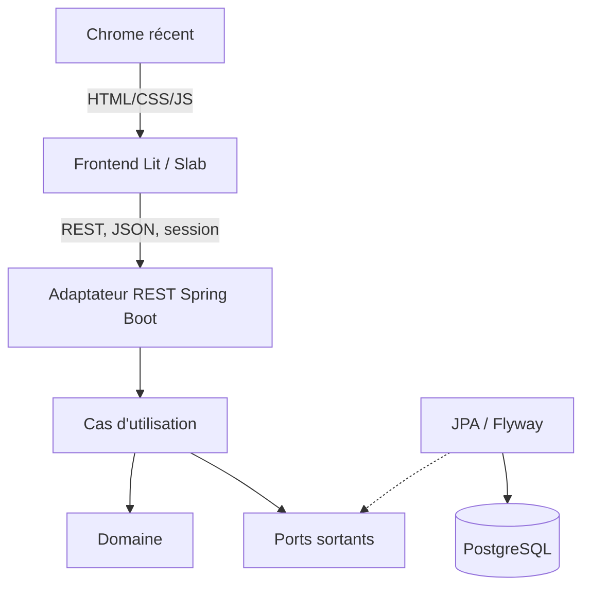

# Pourquoi cette architecture ?

## Sommaire
- [Contexte](#contexte)
- [Architecture retenue](#architecture-retenue)
- [Frontières](#frontières)
- [Compromis](#compromis)

## Contexte

Application de gestion interne, peu d'utilisateurs, navigateur Chrome récent, développée principalement par une personne avec IA. Le problème central est la **centralisation de l'activité**, non la distribution à grande échelle.

## Architecture retenue

Le monorepo facilite la coordination des contrats, des tests et de la documentation. Il **ne signifie pas** que le frontend partage les entités ou les packages du backend. Le monolithe modulaire offre des transactions et un déploiement simples ; les ports isolent les dépendances sensibles.

## Frontières

Le backend applique les règles, les droits et la cohérence des données. Le frontend gère l'interaction et présente les résultats ; il ne calcule pas le niveau d'une compétence d'un collaborateur. L'API est le **contrat de séparation**.

## Compromis

Le cycle Java 27 non-LTS exige de planifier des mises à niveau ; Slab jeune exige un prototype et des tests d'accessibilité. Le déploiement à origine unique simplifie sécurité et exploitation, mais lie la livraison des statiques frontend au backend.

Voir [stack](../reference/architecture/technology-stack.md), [ADR hexagonal](../decisions/ADR-0001-hexagonal.md) et [questions ouvertes](../reference/architecture/open-questions.md).
