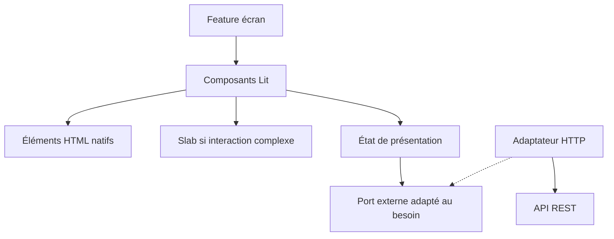

# Pourquoi Lit, Slab et une UI feature-first ?

## Sommaire
- [Motivation](#motivation)
- [Composition](#composition)
- [Points de vigilance](#points-de-vigilance)

## Motivation

Lit fournit des composants réactifs en Web Components standards ; Slab délègue les interactions complexes sans imposer une apparence. La compatibilité Vanilla Web reste utile même si Lit sert à composer les vues.

## Composition

- Le frontend **ne réimplémente pas** règles d'inscription, pertinence des formations ni correspondance métier.
- Le router natif, les formulaires HTML et l'état Lit évitent de reconstruire un framework complet.
- Le partage de composants est gouverné par des besoins d'interface, pas par les entités backend.

## Points de vigilance

Le Shadow DOM isole les sélecteurs CSS ; les tokens traversent les frontières via héritage. Slab peut nécessiter des adaptateurs ciblés pour ses événements et API publiques. Le risque de sa jeunesse est traité comme **dépendance remplaçable**, vérifiée par Playwright/axe et contrôle manuel. Pas de store global ni tableau headless complexe sans besoin.

Voir [conventions composants](../reference/frontend/component-conventions.md), [CSS](../reference/frontend/css-conventions.md), [ADR 0002](../decisions/ADR-0002-lit-slab.md).
