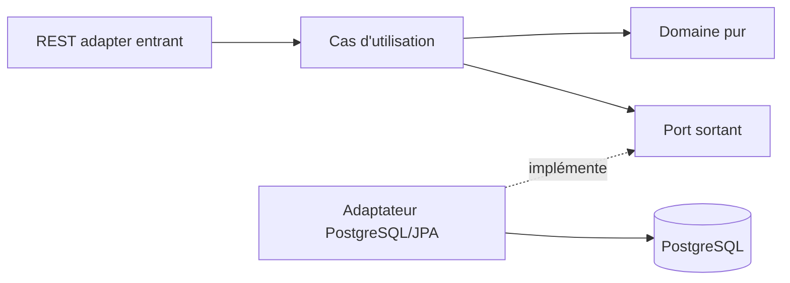

# Structure backend hexagonale

## Sommaire
- [Principes](#principes)
- [Structure cible](#structure-cible)
- [Dépendances](#dépendances)
- [Persistance](#persistance)

## Principes

Monolithe modulaire ; découpage par capacité métier avant le découpage par technologie. Le domaine n'importe **ni Spring, ni JPA, ni DTO REST**. Les cas d'utilisation orchestrent les ports ; les adaptateurs exposent REST et implémentent PostgreSQL, sécurité et autres dépendances.

## Structure cible

```text
backend/src/main/java/<package-racine>/
  catalogue/
    domain/              # profils, compétences, formations, règles pures
    application/         # cas d'utilisation et ports nécessaires
    infrastructure/
      inbound/rest/      # contrôleurs et DTO
      outbound/persistence/ # Spring Data JPA, mapper
  parcours/
    domain/
    application/
    infrastructure/
  activites/
    domain/
    application/
    infrastructure/
  shared/                # strict minimum transversal
```

Cette arborescence est un **exemple adaptable** ; frontières finales des modules à confirmer lors de l'implémentation. Éviter les packages globaux `controllers/`, `services/`, `repositories/` pour toutes les features.



## Dépendances

- Contrôleurs : conversion HTTP, auth et validation de format ; **pas de règles métier**.
- Applications : transactions et orchestration ; ports dépendants du besoin ; pas d'API REST/JPA dans signatures.
- Domaines : entités, valeurs, politiques et invariants ; expliciter les décisions métier côté serveur.
- Ne créer une interface de port que pour une **frontière réelle** (base, service externe, horloge si utile) ; pas d'interface artificielle pour chaque classe.

## Persistance

- PostgreSQL ; migrations Flyway immuables après application ; une évolution = nouvelle migration.
- Entités JPA dans adaptateurs, séparées du modèle domaine si la complexité le justifie ; éviter la fuite `JpaRepository` vers domaine/application.
- Tests d'intégration sur PostgreSQL Testcontainers, pas seulement H2.
- Voir [modèle métier](../domain/domain-model.md) et [contrat API](api-contract.md).
