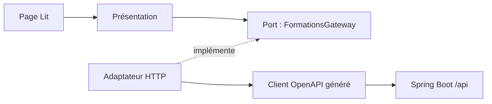

# Structure frontend feature-first

## Sommaire
- [Organisation](#organisation)
- [Responsabilités](#responsabilités)
- [Ports et adaptateurs](#ports-et-adaptateurs)
- [Navigation et état](#navigation-et-état)

## Organisation

```text
frontend/
  src/
    app/                 # bootstrap, navigation, shell, session UI
    features/
      formations/
        components/      # pages/composants Lit métier UI
        presentation/    # état UI, orchestration, mappers de vue
        ports/           # seulement si frontière externe utile
        adapters/        # clients HTTP, mapping DTO
      profils-emploi/
      competences/
      collaborateurs/
      parcours/
      activites/
      dashboard/
    shared/
      ui/                # composants communs, adaptation Slab si utile
      http/              # config du client généré, gestion erreurs
      i18n/              # ressources localisées
    styles/
      tokens/
      main.css
      reset.css
      base.css
      layout.css
      utilities.css
```

Le découpage suit les **tâches de l'interface**, pas les packages du backend, ni nécessairement toutes ses entités. Démarrer petit ; déplacer vers `shared/` seulement après au moins deux usages réels.

## Responsabilités

| Frontend autorisé | Backend exclusif |
|---|---|
| Focus, formulaire, affichage, navigation, tri local de présentation | Calcul des exigences de compétences |
| État `loading/error/empty`, mapping DTO → vue | Couverture des formations pour profils |
| Validation de format et ergonomie | Éligibilité, règles de parcours et invariants |
| Traduction de messages, formats locaux | Autorisation et transactions |

## Ports et adaptateurs



Le port ne doit ni mentionner `fetch` ni exposer des DTO OpenAPI. Exemple indicatif : `listFormations(query): Promise<FormationListView>`. Éviter un port par composant et les enveloppes qui ne font que retransmettre l'appel.

## Navigation et état

- Router minimal : `URLPattern` pour la reconnaissance des routes, History API pour la navigation, événement `popstate`, fallback 404, rechargement direct d'une route géré côté serveur.
- État Lit local par défaut. Contexte de session au niveau application si requis ; **pas de store global automatique**.
- Les vues doivent être résilientes aux retours d'API asynchrones, états vides/erreurs et autorisations refusées.
- Voir [composants](../frontend/component-conventions.md), [conventions CSS](../frontend/css-conventions.md) et [explication](../../explanation/frontend-design.md).
